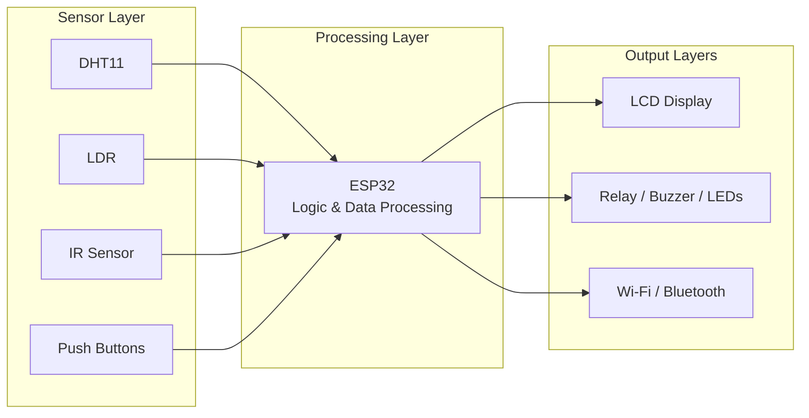

<div align="center">

# ⚡ ESP32 Multi-Sensor Development Board

### A compact, single-layer IoT prototyping platform designed end-to-end in KiCad

<p>
  
  
  
  
  
  
</p>

<p>
  <a href="#-overview">Overview</a> ·
  <a href="#-features">Features</a> ·
  <a href="#-system-architecture">Architecture</a> ·
  <a href="#-hardware-design">Hardware</a> ·
  <a href="#-getting-started">Getting Started</a> ·
  <a href="#-roadmap">Roadmap</a>
</p>

<!-- Replace with your board render / photo -->


</div>

---

## 📌 Overview

This project is a **multifunctional IoT prototyping platform** built around the **ESP32 DevKit**. It brings together sensors, a display unit, and actuator control modules on a single custom PCB, giving developers a ready-to-use base for real-time monitoring and automation.

The board was designed **independently**, from schematic capture to PCB layout, in **KiCad**, with a focus on clean single-layer routing, practical expandability, and hands-on learning.

> **Built for:** Smart Home · Smart Agriculture · Industrial IoT · Environmental Monitoring · Education & Prototyping

---

## ✨ Highlights

| | |
|---|---|
| 📡 **Wireless Ready** | Built-in Wi-Fi and Bluetooth through the ESP32 |
| 🌡️ **Environmental Sensing** | Temperature and humidity via DHT11, light via LDR |
| 🖥️ **Live Display** | 16x2 LCD for real-time readouts |
| 🔌 **Appliance Control** | Relay-based AC/DC load switching |
| 🧩 **Expandable** | GPIO, ADC, I2C, and SPI breakout headers |
| 🔋 **Power Managed** | On-board regulated power supply |
| 🛠️ **Custom PCB** | Compact single-layer design, ~10 integrated components |

---

## 🧰 Integrated Modules

| Module | Function | Interface |
|:--|:--|:--:|
| **ESP32 DevKit** | Main controller, Wi-Fi / BLE | — |
| **DHT11** | Temperature & humidity | Digital |
| **16x2 LCD** | Real-time data display | GPIO / I2C |
| **Relay Module** | AC/DC appliance switching | Digital out |
| **LDR** | Ambient light measurement | ADC |
| **IR Sensor** | Obstacle / proximity detection | Digital in |
| **Buzzer** | Audible alerts | Digital out |
| **Push Buttons** | User input and control | Digital in |
| **LED Indicators** | Status and debugging | Digital out |
| **Expansion Headers** | Add-on sensors and modules | GPIO / ADC / I2C / SPI |

---

## 🏗️ System Architecture



| Layer | Responsibility |
|:--|:--|
| **Sensor Layer** | Collects environmental and physical data |
| **Processing Layer** | ESP32 executes data processing and automation logic |
| **Display Layer** | Real-time visualization on the LCD |
| **Control Layer** | Relay and actuator switching |
| **Communication Layer** | Wireless data transmission over Wi-Fi / Bluetooth |

### ⚙️ Working Principle

1. Sensors continuously capture environmental and physical parameters.
2. The ESP32 processes the data and runs the automation logic.
3. Results are **displayed** on the LCD, **acted upon** through the relay, buzzer, or LEDs, and **transmitted** wirelessly when enabled.

---

## 🔧 Hardware Design

| Parameter | Details |
|:--|:--|
| **EDA Software** | KiCad |
| **PCB Type** | Single-layer |
| **Controller** | ESP32 DevKit (plug-in module) |
| **Power** | On-board regulated supply |
| **Design Focus** | Compact layout, single-layer routing, accessible headers |

<details>
<summary><b>📍 Pin Mapping (click to expand)</b></summary>

<br/>

> Update these values to match your final schematic.

| Peripheral | ESP32 GPIO | Type |
|:--|:--:|:--|
| DHT11 | GPIO ___ | Digital |
| LCD | GPIO ___ | GPIO / I2C |
| Relay | GPIO ___ | Output |
| Buzzer | GPIO ___ | Output |
| Push Buttons | GPIO ___ | Input |
| LDR | GPIO ___ | ADC |
| IR Sensor | GPIO ___ | Input |
| LED Indicators | GPIO ___ | Output |

</details>

<details>
<summary><b>🖼️ Schematic & PCB Previews (click to expand)</b></summary>

<br/>

| Schematic | PCB Layout | 3D View |
|:--:|:--:|:--:|
|  |  |  |

</details>

---

## 🚀 Getting Started

### Prerequisites

- ESP32 DevKit
- [Arduino IDE](https://www.arduino.cc/en/software) with ESP32 board support
- USB cable
- Libraries: `DHT sensor library`, `LiquidCrystal`

### Setup

```bash
# 1. Clone the repository
git clone https://github.com/<your-username>/<repo-name>.git
cd <repo-name>
```

1. **Manufacture the PCB** using the files in `hardware/gerber/`.
2. **Assemble** the components as per `docs/bom.csv` and plug in the ESP32 DevKit.
3. **Open** `firmware/esp32_multisensor/esp32_multisensor.ino` in Arduino IDE.
4. **Select** your ESP32 board and COM port, then **upload**.
5. **Open Serial Monitor** at `115200` baud to verify sensor readings.

---

## 📁 Repository Structure

```
├── hardware/
│   ├── esp32-multisensor.kicad_pro
│   ├── esp32-multisensor.kicad_sch
│   ├── esp32-multisensor.kicad_pcb
│   └── gerber/
├── firmware/
│   └── esp32_multisensor/
├── docs/
│   ├── schematic.pdf
│   ├── bom.csv
│   └── images/
├── LICENSE
└── README.md
```

---

## 🌍 Applications

| Domain | Use Case |
|:--|:--|
| 🏠 **Smart Home** | Appliance automation, climate and light monitoring |
| 🌾 **Smart Agriculture** | Field condition monitoring and irrigation control |
| 🏭 **Industrial Safety** | Threshold alerts and equipment switching |
| 📊 **Data Logging** | Environmental data collection |
| 🎓 **Education** | Hands-on embedded and IoT learning platform |

---

## 🧠 Skills Demonstrated

`Embedded System Design` · `Multi-Sensor Interfacing` · `PCB Layout Optimization` · `Schematic Design` · `IoT Communication Integration` · `Hardware-Software Integration` · `Power Management Design`

**Tech stack:** Embedded C / Arduino IDE · KiCad · Wi-Fi protocols · Serial debugging · Hardware testing instruments

---

## 🗺️ Roadmap

- [x] Schematic design in KiCad
- [x] Single-layer PCB layout
- [x] Multi-sensor integration
- [x] Relay-based load control
- [ ] Upgrade to a two-layer PCB for better routing and noise performance
- [ ] Replace DHT11 with DHT22 / BME280 for higher accuracy
- [ ] Cloud dashboard integration (MQTT / ThingsBoard / Blynk)
- [ ] OLED / TFT display option
- [ ] Enhanced isolation and protection for mains-side switching

---

## ⚠️ Safety Notice

> This board can switch **AC mains loads** through the relay. Mains voltage is dangerous. Use proper insulation, isolation, and an enclosure, and only work with mains wiring if you are qualified to do so.

---

## 📄 License

Distributed under the **MIT License**. See [`LICENSE`](LICENSE) for details.

---

<div align="center">

### 👤 Author

**Nikhil Misal**
Embedded Systems · PCB Design · IoT

**Nikhil Misal**
Embedded Systems · PCB Design · IoT

[](https://github.com/Nikhil-Misal-24)
[](https://linkedin.com/in/nikhil-misal24)

⭐ If you found this project useful, consider giving it a star.

</div>
